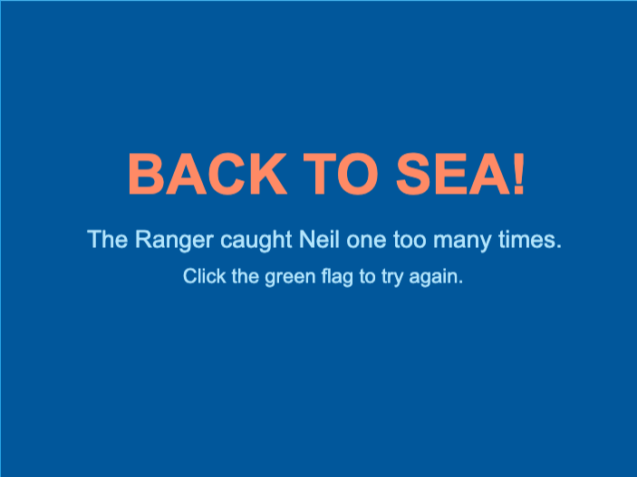
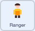
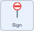

## Back to the sea, Neil

End the game when **Neil** runs out of lives.

> [!TASK]
>
> 
>
> Open the **Backdrops** tab. Hover over **Choose a Backdrop** and click on **Paint** to make a new, blank backdrop. Call it `game over`{:class="block3looks"}, for when **Neil** runs out of lives. Design it however you like.

Here's the `game over`{:class="block3looks"} backdrop from the example project:



> [!TASK]
>
> **Neil** loses when he runs out of lives. Add a new script — much like your winning one — using a `forever`{:class="block3control"} loop and an `if ... then`{:class="block3control"} block.
>
> When `lives`{:class="block3variables"} is less than `1`{:class="block3operators"} and `game over`{:class="block3variables"} is `0`{:class="block3operators"}, switch to your `game over`{:class="block3looks"} backdrop and set `game over`{:class="block3variables"} to `1`{:class="block3variables"}.
>
> 
>
> ```blocks3
> when green flag clicked
> forever
> if <<(lives) < (1)> and <(game over) = (0)>> then
> switch backdrop to (game over v)
> set [game over v] to (1)
> end
> end
> ```

> [!TASK]
>
> Make a new `broadcast`{:class="block3events"} message called `game over`{:class="block3events"}. Add a `broadcast`{:class="block3events"} block to your new script, so the other sprites know the game has ended.
>
> 
>
> ```blocks3
> if <<(lives) < (1)> and <(game over) = (0)>> then
> switch backdrop to (game over v)
> set [game over v] to (1)
> +broadcast (game over v)
> end
> ```

> [!TASK]
>
> Add a `when I receive`{:class="block3events"} block for the `game over`{:class="block3events"} message, and use `say () for () seconds`{:class="block3looks"} to make **Ranger** say “Off you go!”.
>
> 
>
> ```blocks3
> when I receive (game over v)
> say [Off you go!] for (1) seconds
> ```

> [!TASK]
>
> When the game ends, all the stop sign clones are still lying around town. Get them to tidy themselves up.
>
> At the top of the clone's `forever`{:class="block3control"} loop, add an `if ... then`{:class="block3control"} block that checks whether `game over`{:class="block3variables"} is `1`{:class="block3operators"}. If it is, `delete this clone`{:class="block3control"}. Check this before the smash condition so the player cannot score after the game ends.
>
> 
>
> ```blocks3
> when I start as a clone
> forever
> +if <(game over) = (1)> then
> delete this clone
> end
> if <<touching (Neil v)?> and <key (space v) pressed?>> then
> change [score v] by (10)
> change [stuff to smash v] by (-1)
> delete this clone
> end
> end
> ```

## Now run your code

Click on the green flag and let **Ranger** catch **Neil** three times. The `game over`{:class="block3looks"} backdrop appears, **Ranger** says “Off you go!”, and the leftover stop signs disappear.

Try holding the space bar as you lose your last life. Your score should stop changing when the game ends.
